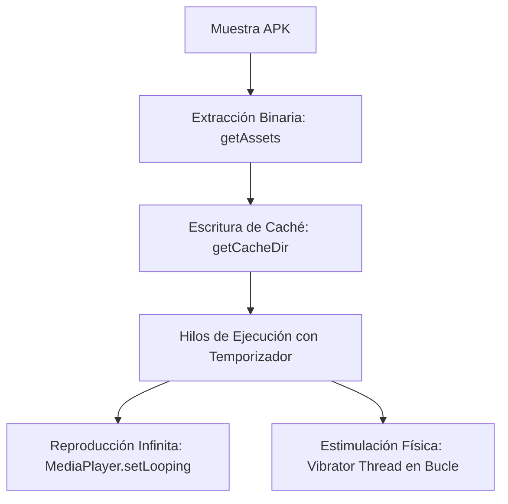

# 🔬 Reporte de Ingeniería Inversa: Screen Locker "Verity 2"

**Analista:** Sylvio Andrés Burgos (misteorecandy)  
**Clasificación:** Malware Móvil / Fake Ransomware (Screen Locker)  
**Ecosistema:** Android OS (API 21 a API 34)  
**Entorno de Análisis:** Sandbox Aislado / Análisis Estático Estructurado  

---

## ⚡ 1. Resumen Ejecutivo

El espécimen **"Verity 2"** (desplegado bajo el paquete raíz `com.my.newproject4`) representa una clase de amenaza móvil diseñada específicamente para el secuestro de la interfaz gráfica de usuario (*User Interface Lockdown*). 

A diferencia de las variantes de ransomware criptográfico que ejecutan rutinas de cifrado sobre el sistema de archivos, este troyano opera como un **Lock Screen invasivo**. El vector combina persistencia absoluta en el arranque del núcleo (*Kernel Boot*), inyección de ventanas flotantes indestructibles y tácticas de **extorsión psicológica mediante saturación sensorial** (reproducción acústica distorsionada en bucle y vibración asíncrona por hardware) simulando un fallo crítico del sistema (*Kernel Panic / Upload Mode*).

---

## 🛡️ 2. Arquitectura del Vector de Persistencia (`BootReceiver.java`)

El componente `BootReceiver` actúa como el disparador estratégico del espécimen, garantizando la ejecución forzada del entorno malicioso antes de que el subsistema gráfico nativo del dispositivo otorgue el control al usuario.

### Atributos Técnicos del Manifiesto

*   **Prioridad de Filtro (`android:priority="1000"`):** Asegura precedencia absoluta sobre los receptores legítimos del sistema.
*   **Gatillo de Difusión (`android:intent.action.BOOT_COMPLETED`):** Activa el payload inmediatamente al finalizar la carga del Kernel.
*   **Evasión de Credenciales (`android:intent.action.LOCKED_BOOT_COMPLETED`):** Ejecuta el código incluso antes de que el usuario introduzca su PIN/Patrón inicial.

### Mecanismo de Invocación de Tarea Raíz
Tras capturar el evento de arranque, el receptor inicializa la actividad principal inyectando flags críticos del SDK de Android para aislar el proceso:

```java
Intent intent2 = new Intent(context, (Class<?>) MainActivity.class);
intent2.addFlags(268435456); // FLAG_ACTIVITY_NEW_TASK -> Forzado de ventana raíz independiente
intent2.addFlags(67108864);  // FLAG_ACTIVITY_CLEAR_TOP -> Destrucción de la pila de apps en RAM
context.startActivity(intent2);
```

---

## ⚙️ 3. Ingeniería Forense del Secuestro Gráfico (`MainActivity.java`)

La lógica central alojada en `MainActivity.java` evidencia un abuso avanzado de las APIs de accesibilidad y del administrador de ventanas (`WindowManager`) para anular de forma absoluta las vías de escape del sistema operativo.

### A. Ecuación de Activación y Monitoreo de Red
El malware implementa rutinas de validación constante para verificar si el hardware se encuentra en un estado óptimo para la extorsión visual, evaluando la siguiente condición lógica:

$$\text{Estado} = \text{Constant.isScreenOn}(x) \land \text{Constant.isNetworkAvailable}(x)$$

### B. Abuso del Sistema de Ventanas Flotantes (`Overlay Injection`)
Dependiendo del nivel de API detectado en el terminal (`Build.VERSION.SDK_INT`), el troyano altera los parámetros de visualización para superponerse a la barra de estado y menús de apagado de fábrica:

*   **En API $\ge$ 26 (Android 8.0+):** Modifica los parámetros e inyecta una capa de tipo `2038` (`TYPE_APPLICATION_OVERLAY`).
*   **En APIs heredadas:** Recurre a los tipos `2002` (`TYPE_SYSTEM_ALERT`) o `2010` (`TYPE_SYSTEM_ERROR`).
*   **Expansión Absoluta:** Aplica la propiedad `layoutInDisplayCutoutMode = 1` para obligar a la ventana maliciosa a cubrir por completo las muescas físicas (*notches*) de la pantalla, absorbiendo el 100% de las pulsaciones táctiles.

### C. Desactivación de Seguridad de Fábrica (`Keyguard Bypass`)
El código interactúa con la clase `KeyguardManager` utilizando los métodos nativos `requestDismissKeyguard` y `disableKeyguard()`. Esto deshabilita la pantalla de bloqueo legítima del terminal, impidiendo el bloqueo preventivo del usuario. 

Adicionalmente, la siguiente llamada fuerza un estado binario en el sistema que oculta la barra de estado superior, las notificaciones emergentes y anula los botones virtuales de navegación nativos (Atrás, Inicio, Recientes):

```java
viewInflate.setSystemUiVisibility(5894);
```

---

## 🔊 4. Rutina Acústica de Saturación Sensorial (Módulo de Pánico)

Para doblegar la resistencia del usuario, el código implementa un ciclo de extorsión acústica estructurado en hilos asíncronos y extracción de recursos en tiempo de ejecución:



1.  **Extracción de Payloads Ocultos:** El malware abre flujos de lectura desde los recursos empaquetados (`getAssets().open()`), abstrayendo archivos de audio distorsionados de baja frecuencia y escribiéndolos localmente mediante `FileOutputStream` en el directorio privado `getCacheDir()`.
2.  **Bucle de Audio Recursivo:** Vincula un planificador `Timer` acoplado a un objeto `Runnable` con retrasos fijos secuenciales ($35000L$, $45000L$, $125000L$) que fuerzan la ejecución iterativa del `MediaPlayer`, imposibilitando la liberación del canal de audio por parte del mezclador del sistema.
3.  **Sincronización por Vibración:** Inicializa un proceso exclusivo a través de la llamada `new Thread(new n(this, vibrator)).start();`, obligando al motor de vibración del hardware a activarse de forma intermitente en consonancia con las frecuencias del audio para simular un colapso físico del procesador.

---

## 🛑 5. Conclusiones y Procedimientos de Mitigación

"Verity 2" es un claro ejemplo de malware móvil táctico que no requiere explotación de corrupción de memoria en el Kernel para neutralizar un dispositivo, bastando con el secuestro legítimo de las interfaces gráficas proporcionadas por el SDK.

Debido a la persistencia agresiva inyectada con prioridad máxima antes de la inicialización del perfil de usuario, su eliminación a través de la pantalla táctil es imposible. Los métodos de respuesta ante incidentes efectivos son:

1.  **Aislamiento por Modo Seguro (Safe Mode):** Reiniciar el hardware manteniendo presionada la tecla física de bajar volumen para impedir la carga en memoria de los receptores de difusión (`BroadcastReceivers`) de terceros.
2.  **Depuración Remota por Comandos (Android Debug Bridge):** Si el terminal posee las opciones de desarrollo activas, se debe proceder a la terminación forzada del subproceso y la remoción absoluta del paquete mediante la terminal de comandos:

```bash
adb shell am force-stop com.my.newproject4
adb shell pm uninstall com.my.newproject4
```

---
*Disclaimer: La información contenida en este documento se expone exclusivamente con objetivos de investigación académica, documentación de portafolio profesional y desarrollo de firmas defensivas en ciberseguridad.*
